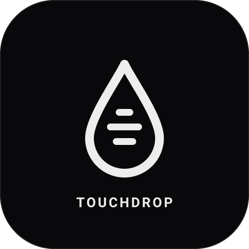
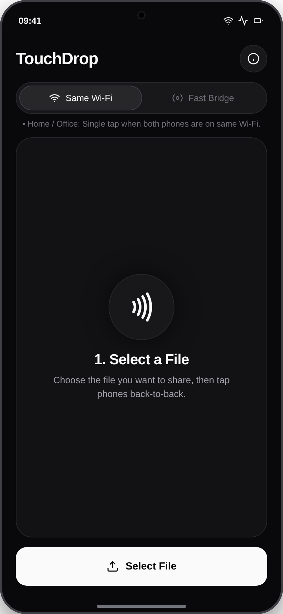
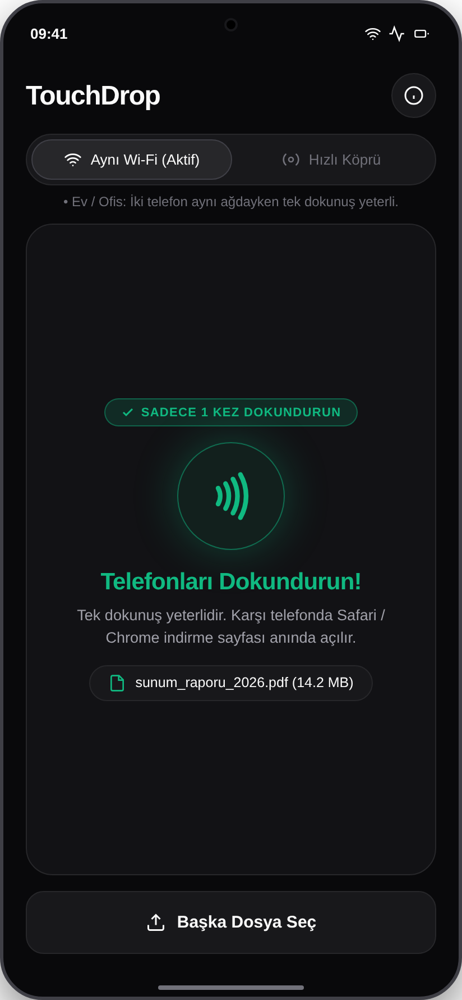
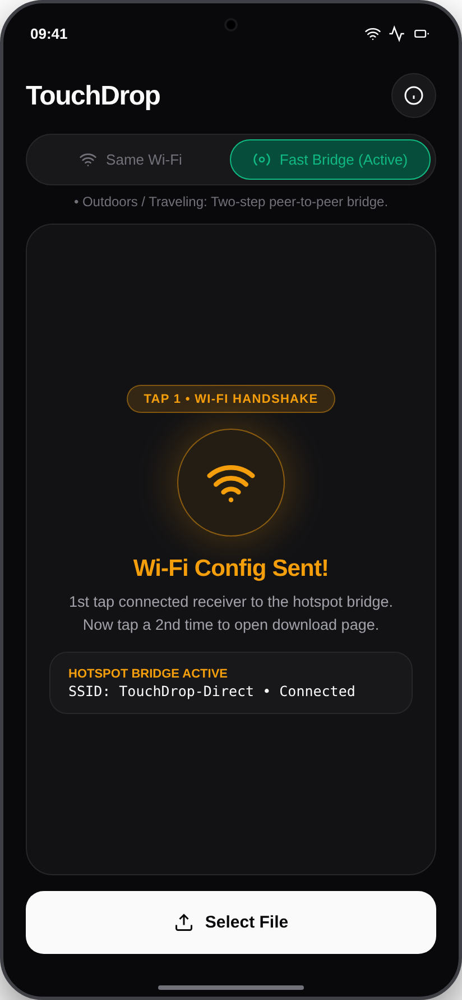
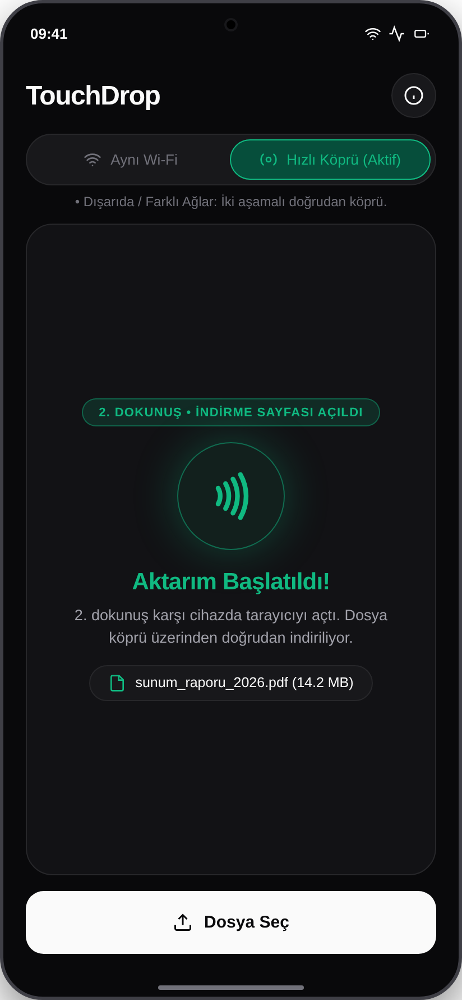
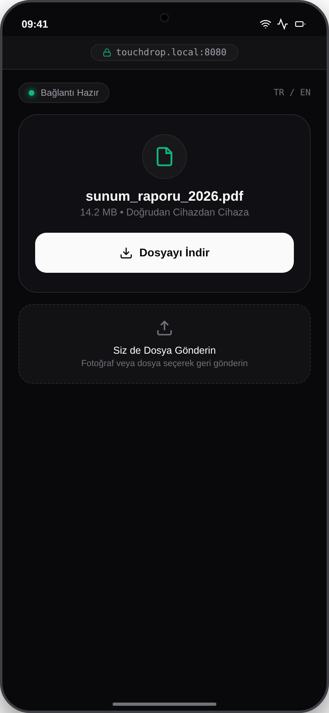

# TouchDrop

<p align="center">
  
</p>

<p align="center">
  <strong>Fast, Zero-Internet Offline P2P File Sharing for Android & iOS</strong><br />
  Tap devices back-to-back via NFC and stream files directly over gigabit local Wi-Fi.
</p>

<p align="center">
  <a href="https://github.com/yufuus/TouchDrop/releases"></a>
  <a href="LICENSE"></a>
  
  
  
</p>

---

## Highlights

- ⚡ **Cross-Platform (Android & iOS / iPhone):** Transfer files to any iPhone or iPad without installing an app on the Apple device. iPhones automatically read the NFC tag and open the download page directly in Safari.
- 📶 **Zero Internet Required:** Completely peer-to-peer. Works in remote areas, outdoors, airplanes, or home/office Wi-Fi.
- 🔒 **100% Private & Conconfined:** Zero cloud servers, zero analytics, zero data logging. Files travel directly device-to-device.
- 🚀 **Zero-Copy Streaming:** NanoHTTPD disk-to-socket streaming sends large videos and archives with minimal RAM consumption.
- 🛡️ **Hardened Security:** Canonical path boundaries prevent path traversal attacks, and filename sanitization strips null bytes and malicious characters.

---

## 📱 Screenshots

<p align="center">
  
  
  
  
  
</p>

<p align="center">
  <sub><b>From left to right:</b> 1. Main Dashboard & Mode Selection &nbsp;|&nbsp; 2. Single-Tap NFC Ready &nbsp;|&nbsp; 3. Hotspot Bridge Step 1 &nbsp;|&nbsp; 4. Transfer Stream Ready &nbsp;|&nbsp; 5. iOS Safari / Browser Receiver</sub>
</p>

---

## How It Works

TouchDrop provides two flexible operational modes:

### 1. Same Wi-Fi Mode (Single Tap)
- **Use Case:** Both phones are connected to the same home, office, or school Wi-Fi network.
- **Action:** Select your file and tap the phones back-to-back once.
- **Result:** The receiving device (Android Chrome or iPhone Safari) instantly opens the local download page and saves the file at full Wi-Fi speed.

### 2. Fast Bridge Mode (Two Taps)
- **Use Case:** Outdoors, traveling, or on separate networks with no shared Wi-Fi.
- **Action:**
  1. **First Tap:** Receiver phone taps sender to automatically connect to an encrypted, temporary local-only hotspot bridge.
  2. **Second Tap:** Receiver phone taps again to open the high-speed transfer page.
- **Result:** High-speed peer-to-peer transfer without using mobile cellular data.

---

## iOS / iPhone Support (Zero-Install)

No app installation is needed on the receiver's iPhone:
1. Hold the top edge of the iPhone against the Android phone's NFC area.
2. An iOS system notification ("NFC Tag: Open in Safari") appears automatically.
3. Tap the notification to stream and save the file in Safari / Files app.

---

## Architecture & Technology Stack

- **Android Client:** Native Kotlin, Android SDK (API 26+), ViewBinding, Coroutines.
- **NFC HCE Engine:** `HostApduService` emulating NFC Forum Type 4 Tag v2.0 (AID `D2760000850101`) dispatching WSC and URI NDEF records.
- **Local Embedded Server:** NanoHTTPD engine with chunked zero-copy streaming.
- **Design System:** Obsidian Dark and Cool Slate Gray themes inspired by modern minimalist design.

---

## Download APK

Direct download links for the latest signed releases:

- [Download TouchDrop v1.9.0 Release APK](https://pdf.gocer.me/agy/TouchDrop-v1.9.0-release.apk)
- [Download Latest APK](https://pdf.gocer.me/agy/TouchDrop-latest.apk)

---

## Building from Source

```bash
git clone https://github.com/yufuus/TouchDrop.git
cd TouchDrop
./gradlew assembleRelease
```

The APK will be generated at `app/build/outputs/apk/release/app-release.apk`.

---

## License

This project is licensed under the MIT License - see the [LICENSE](LICENSE) file for details.
